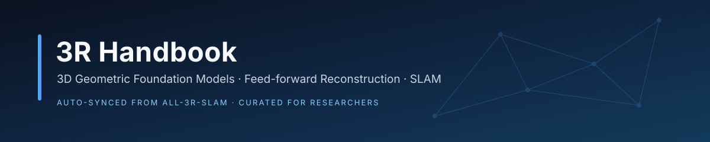

<p align="center"></p>

# 3R Handbook

[](https://creativecommons.org/licenses/by/4.0/)
[](.github/workflows/sync-upstream.yml)
[](https://github.com/jzx05/3R-Handbook/actions/workflows/sync-upstream.yml)
[](data/stats.json)
[](https://github.com/3D-Vision-World/All-3R-SLAM-in-this-Repo)

一个面向 **3D 几何基础模型（3R）· 前馈式重建 · SLAM** 的自动化科研手册。

它从一个持续维护的上游论文索引抓取条目，标准化成机器可读的 `data/papers.json`，
再生成分类页、时间线、会议统计和每日同步报告。**上游 README 变化才会产生提交**，
所以它既是可浏览的手册，也是一个可查询、可追溯到来源的论文数据库。

> 本仓库只保存标题、作者、会议、摘要（来自 arXiv API）和链接等元数据，并明确标注来源；
> 上游 README 未声明许可证，因此不复制其正文。深度解读以 `notes/` 中的人工/agent 稿件为准。

## 数据快照

<!-- AUTO:STATS:BEGIN -->
> **163** 篇论文 · **6** 个分类 · 人工补充 **1** 篇 · 最近同步 **2026-11-13 17:49 UTC**
>
> 数据源：[3D-Vision-World/All-3R-SLAM-in-this-Repo](https://github.com/3D-Vision-World/All-3R-SLAM-in-this-Repo)@[afadc022916f](https://github.com/3D-Vision-World/All-3R-SLAM-in-this-Repo/commit/afadc022916f) · 2024 年 6 篇 · 2025 年 53 篇 · 2026 年 104 篇
<!-- AUTO:STATS:END -->

## 导航

| 入口 | 内容 |
|---|---|
| [论文总览](papers/README.md) | 按分类浏览全部条目，含 Code / Project 链接 |
| [分类索引](#分类) | 3R / SLAM / Calibration / Loop Closure / Downstream |
| [时间线](cheat-sheet/timeline.md) | 按年份统计的论文分布（自动生成） |
| [会议统计](cheat-sheet/venue-stats.md) | CVPR / ICCV / ECCV / arXiv 等分布（自动生成） |
| [同步归档](reports/README.md) | 每次新增 / 更新 / 移除的日报 |
| [深度解析](theory/README.md) | 长篇技术解析（已收录 DUSt3R） |
| [深度笔记](notes/README.md) | 按模板撰写的方法解读、复现要点与失败模式 |
| [电子书大纲](book/BOOK.md) | 从问题定义到部署的章节规划 |
| [Pipeline 文档](docs/PIPELINE.md) | 抓取、解析、富化、生成、提交的完整流程 |
| [AGENTS.md](AGENTS.md) | 自动化 agent 的写入边界与写作规范 |

## 分类

<!-- AUTO:SECTIONS:BEGIN -->
| 分类 | 数量 | 入口 |
|---|---:|---|
| Survey Paper | 2 | [survey](papers/survey.md) |
| 3D Geometric Foundation Models (3R) | 68 | [3r](papers/3r.md) |
| SLAM | 85 | [slam](papers/slam.md) |
| Calibration | 1 | [calibration](papers/calibration.md) |
| Loop Closure Detection & Place Recognition | 4 | [loop-closure](papers/loop-closure.md) |
| Downstream Tasks | 3 | [downstream](papers/downstream.md) |
| 已移除（历史） | 0 | [removed](papers/removed.md) |
<!-- AUTO:SECTIONS:END -->

## 最近新增

<!-- AUTO:RECENT:BEGIN -->
- [Kosmo-GFM: A Production-Ready Geometry Foundation Model](https://arxiv.org/pdf/2611.16840) — *arXiv 2026* · 3D Geometric Foundation Models (3R)
<!-- AUTO:RECENT:END -->

## 自动化是怎么工作的

```text
All-3R-SLAM README ──fetch/ETag──▶ data/upstream/README.md
                                      │
                                      ▼
                              parse bullets + links
                                      │
                     ┌────────────────┼────────────────┐
                     ▼                ▼                ▼
              data/papers.json   arXiv API 富化    manual supplements
                     │                │                │
                     └────────────────┼────────────────┘
                                      ▼
                    papers/ · cheat-sheet/ · reports/
                                      │
                                      ▼
                        commit only when content changed
```

- **每 2 小时**轮询上游 `README.md`，用 ETag + SHA-256 双重判断是否变化。
- 解析 `- Title, *Venue Year*. [[Paper](...)] [[Code](...)]` 格式；对缺失括号、空链接、
  `Paper-todo` 等脏数据做了容错。
- 用标题的稳定哈希做 ID：上游改标题才会被视为“新论文”，并在日报里显示为新增 + 移除。
- 新条目通过 arXiv API 补全作者、发布日期、分类和摘要；结果缓存在 `data/arxiv-cache.json`。
- 生成 `papers/`、`cheat-sheet/`、`reports/daily/` 与 README 的自动区块；有变化才提交。
- 上游异常（抓取失败、条目数骤降 >50%）默认**拒绝更新**，避免一次网络故障清空目录。

## 本地运行

```bash
# 完整同步（抓取 + 解析 + arXiv 富化 + 生成页面）
python3 scripts/sync_upstream.py

# 只用本地快照，不联网
python3 scripts/sync_upstream.py --offline

# 预览，不写文件
python3 scripts/sync_upstream.py --dry-run

# 只重建页面（数据已在 data/papers.json）
python3 scripts/build_pages.py

# 结构审计；--check-links 会额外检查链接
python3 scripts/audit.py
python3 scripts/audit.py --check-links

# 回归测试
python3 -m unittest discover -s scripts -p 'test_*.py' -v
```

只需要 Python 3.9+，无第三方依赖。

## 写入规范（给人和 agent）

- **不要手改自动生成文件**：`data/papers.json`、`data/papers.jsonl`、`papers/*.md`、
  `cheat-sheet/timeline.md`、`cheat-sheet/venue-stats.md`、`reports/daily/*`、README 的
  `AUTO:*` 区块。它们会被下一次同步覆盖。
- **人工补充论文**：编辑 `data/supplements/papers.json`，字段见现有示例；条目会标记为
  `source=manual`，不会因上游删除而消失。
- **写深度笔记**：复制 `notes/_template.md`，每个数字必须能在论文原文找到，并附来源链接。
- **写论文解析**：统一用 `theory/_template.md`，文件名 `<slug>_dissection.md`；先跑
  `python3 scripts/new_dissection.py`，提交前跑 `python3 scripts/audit_theory.py`。
  自动化流程见 [`.claude/skills/paper-dissection/SKILL.md`](.claude/skills/paper-dissection/SKILL.md)。
- 详细边界见 [AGENTS.md](AGENTS.md)。

## 来源与致谢

- 主要数据源：[`3D-Vision-World/All-3R-SLAM-in-this-Repo`](https://github.com/3D-Vision-World/All-3R-SLAM-in-this-Repo)
- 结构与选题参考：[`ruili3/awesome-dust3r`](https://github.com/ruili3/awesome-dust3r)、
  [`minoTrey/DUSt3R-Paper-Collection`](https://github.com/minoTrey/DUSt3R-Paper-Collection)、
  [`chicleee/End-to-End-3D-Reconstruction-Paper-List`](https://github.com/chicleee/End-to-End-3D-Reconstruction-Paper-List)
- 姊妹手册：[VLA-Handbook](https://github.com/sou350121/VLA-Handbook) ·
  [Spatial-Intelligence-Handbook](https://github.com/sou350121/Spatial-Intelligence-Handbook)

## License

本仓库原创内容采用 [CC BY 4.0](LICENSE)。论文标题、作者、会议与摘要的版权归原作者/出版方；
摘要通过 arXiv API 获取并注明来源。上游索引的收录与排序版权归其维护者。
